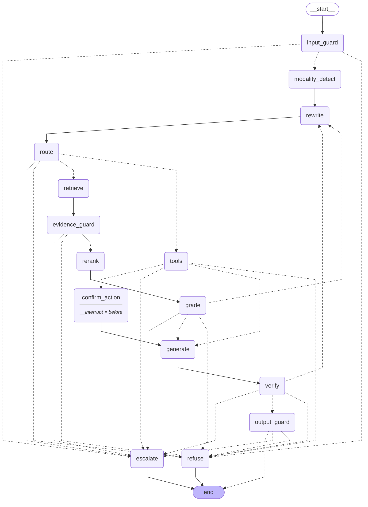

# Agent graph

The API agent is a checkpointed LangGraph state machine. Identity and retrieval
scope are copied into `AgentState` only by the authenticated server boundary;
browser input cannot provide `tenant_id` or scopes. Raw credentials are never
part of graph state.



## Runtime invariants

- The checkpoint `thread_id` is a collision-safe composition of the authenticated
  session ID and conversation ID.
- Production construction uses `AsyncPostgresSaver`; checkpoint schema setup is
  an explicit deployment operation.
- The graph interrupts before `confirm_action`, so a side effect cannot proceed
  without a persisted confirmation boundary.
- Every node runs through the same timeout, budget-accounting, and span-hook
  wrapper. The span hook is intentionally a no-op until OTel instrumentation is
  enabled.
- `recursion_limit` and `max_rewrites` are independent: the first bounds all
  graph steps, while the second explicitly bounds rewrite loops.
- Offline and CI construction injects `FakeLlm` and `HashingEmbedder`; it does
  not require cloud credentials.
- Retrieval and tools remain topology stubs. Generation and verification use
  schema-constrained LLM calls, strict citation checks, and extractive fallback.
  Guards, refusal, and escalation are executable safety behavior.

Regenerate this page with:

```shell
python -m aegon_api.graph.diagram
```
