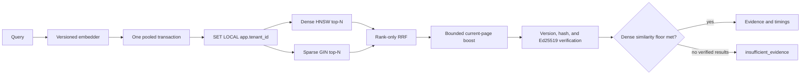

# Hybrid retrieval

The API retrieval layer returns verified text evidence. It has no dependency on an LLM,
generation prompt, or reranker.

## API contract

`HybridRetriever.retrieve(query, tenant_ctx, k)` returns a `RetrievalResult`. Its `evidence`
tuple contains at most `k` `Evidence` values; the envelope also carries the explicit `signal`
and per-stage `timings` required by callers. Returning an envelope rather than a bare evidence
list ensures an empty successful search is distinguishable from `insufficient_evidence`.



## Security boundary

`TenantContext` is server-derived and contains the tenant ID, allowed access levels, and
optional current page URI. Both ranked queries run inside one pooled transaction after
`set_config('app.tenant_id', tenant_id, true)`. PostgreSQL RLS remains authoritative. The SQL
also filters access level and embedding identity before ranking, and the application repeats
those checks before fusion as defense in depth.

All SQL values are parameters. Access levels are adapted as `text[]`; the query vector is a
parameter cast to `vector`. The API database role must remain `NOBYPASSRLS`.

## Ranking

Dense retrieval orders by cosine distance using `chunks_embedding_hnsw_idx`. Sparse retrieval
uses the generated English `tsvector` and `chunks_tsv_gin_idx`. Raw dense and sparse scores are
never added. For rank $r$ in each result list, reciprocal-rank fusion contributes

$$
\operatorname{RRF}(d) = \sum_i \frac{1}{k_{RRF} + r_i(d)}
$$

with configurable $k_{RRF}=60$. A matching current-page URI receives at most one first-rank
RRF contribution; the default boost is `0.005`.

The configured dense cosine-similarity floor is applied before evidence is returned. Sparse-only
matches cannot bypass that grounding floor. A retrieval with no compatible, verified candidate
returns `signal="insufficient_evidence"` and an empty evidence tuple.

## Integrity and compatibility

Candidates must match the query embedder's model ID and version. `Ed25519ChunkVerifier` checks
the SHA-256 content digest, the network-order binary64 embedding digest, and the RFC 8785
canonical signature used by ingestion. Public-key resolution is tenant scoped and injected;
private signing material never enters the API.

## Timeouts and observability

Embedding, dense SQL, sparse SQL, fusion, and verification each have independent timeouts.
`RetrievalResult.timings` reports milliseconds for every stage and total wall time. A timeout
raises Python's `TimeoutError` for the API error boundary to map to the stable `timeout` code.

## Query-plan verification

The migration integration test disables sequential scans for its small fixture, runs `EXPLAIN`
on the cosine-distance query, and asserts `chunks_embedding_hnsw_idx` appears in the plan. Run:

```bash
pytest infra/migrations/tests/test_migrations.py::test_vector_query_plan_uses_hnsw_index
```

The seeded acceptance test runs the complete retriever through an async connection pool as the
`aegon_app` role. It covers known-answer retrieval, cross-tenant refusal, tamper rejection, and
the similarity floor against PostgreSQL rather than mocked rows:

```bash
pytest infra/migrations/tests/test_migrations.py::test_hybrid_retrieval_seeded_acceptance
```

Changing the dense `ORDER BY embedding <=> ... LIMIT ...` shape requires updating and rerunning
that plan test against PostgreSQL with pgvector; unit mocks are not sufficient evidence.